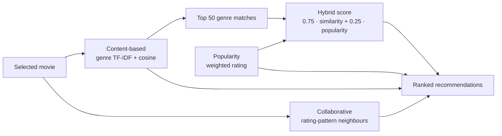
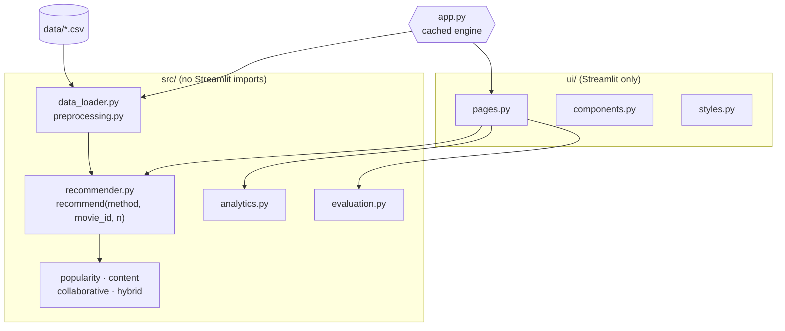

<div align="center">

# 🎬 CineMatch

### Movie recommendation system built with Streamlit and MovieLens Small


</div>

---

## 📖 Overview

CineMatch recommends movies from the **MovieLens Small** dataset using four classic approaches: **popularity**, **content-based** (genres), **collaborative filtering** (rating patterns) and a **hybrid**. It was converted from a Jupyter notebook into a normal Python project that runs in VS Code. The notebook is optional.

> ℹ️ Recommendations start from a **movie**, not a user. None of the models is personalised, and no score is a probability that you will enjoy a movie.

---

## ✨ Features

| Page | What it does |
|------|--------------|
| 🏠 **Home** | Branding, dataset statistics, quick recommender, top-rated picks |
| 🎯 **Recommendations** | Pick a movie, a method and a result count; see score explanations |
| 🔎 **Explore Movies** | Title search, genre filters (any/all), sorting by popularity, rating, rating count, title or year, pagination |
| 📊 **Model Insights** | Rating and genre distributions, most/highest-rated movies, on-demand offline evaluation |
| 📚 **About the Models** | Plain-language comparison table and formulas |

- Friendly setup screen instead of a crash when the dataset is missing
- Movies identified by `movieId`, so duplicate titles are handled (`[id N]` in the dropdown)
- Pytest suite using tiny temporary datasets, no internet needed

---

## 🧠 The four models

| Model | File | Idea |
|-------|------|------|
| **Popularity** | `src/popularity_model.py` | Weighted rating: `v/(v+m)·R + m/(v+m)·C` |
| **Content-based** | `src/content_model.py` | Genres → TF-IDF → cosine similarity (genres only) |
| **Collaborative** | `src/collaborative_model.py` | Sparse movie × user matrix → `NearestNeighbors` (cosine, brute force) |
| **Hybrid** | `src/hybrid_model.py` | `0.75 · similarity + 0.25 · popularity_normalized` over the 50 most genre-similar movies |

For popularity, `R` is the movie's mean rating, `v` its rating count, `C` the global mean and `m` the 75th percentile of rating counts. Hybrid weights live in `src/config.py`.



### Cold start

| Method | Movie with no ratings |
|--------|-----------------------|
| Popularity | Works (ignores the selected movie except to exclude it) |
| Content-based | Works (uses genres) |
| Hybrid | Works (uses genres; popularity part is 0) |
| Collaborative | **Cannot**; the app says so and does not silently switch method |

---

## 🏗️ Architecture



The engine is built once with `st.cache_resource`; a file-size/mtime signature refreshes the cache when the CSVs change.

---

## 📁 Project structure

```text
CineMatch/
├── app.py                       Streamlit entry point
├── requirements.txt             Runtime dependencies
├── requirements-dev.txt         + pytest
├── pytest.ini
├── .env.example                 Optional: CINEMATCH_DATA_DIR
├── .streamlit/config.toml       Dark theme
├── .vscode/                     settings.json, launch.json
├── data/                        Put the dataset here (see data/README.md)
├── notebooks/                   Original notebook (optional)
├── scripts/download_dataset.py  Safe dataset download / unzip helper
├── src/                         ML and data code
│   ├── config.py  utils.py  data_loader.py  preprocessing.py
│   ├── popularity_model.py  content_model.py
│   ├── collaborative_model.py  hybrid_model.py
│   ├── recommender.py  analytics.py  evaluation.py
├── ui/                          styles.py, components.py, pages.py
└── tests/                       pytest suite
```

---

## 🚀 Quick start (Windows, VS Code terminal)

Open the `CineMatch` folder in VS Code, open a terminal, then:

```powershell
py -m venv .venv
.venv\Scripts\Activate.ps1
python -m pip install --upgrade pip
python -m pip install -r requirements.txt
python scripts/download_dataset.py
python -m streamlit run app.py
```

The app opens at <http://localhost:8501>. Press `Ctrl+C` to stop it.

> The dataset is **not** included. `download_dataset.py` fetches the official MovieLens Small zip (internet needed once). If you already have a zip, run:
> `python scripts/download_dataset.py --zip "C:\path\to\movie dataset.zip"`

### 🛠️ Troubleshooting

| Problem | Fix |
|---|---|
| `Activate.ps1 cannot be loaded because running scripts is disabled` | `Set-ExecutionPolicy -Scope CurrentUser RemoteSigned`, answer `Y`, activate again. Or use `.venv\Scripts\activate.bat` in Command Prompt. |
| `py` / `python` not recognized | Install Python 3.10+ from python.org with **Add python.exe to PATH**, then reopen the terminal. |
| `pip install` fails | Update pip, check internet/proxy, make sure the venv is active (`(.venv)` in the prompt). Use 64-bit Python 3.10–3.13. |
| App says dataset is missing | Run `python scripts/download_dataset.py` (or `--zip ...`), then refresh the page. |
| `streamlit` not recognized | Start it with `python -m streamlit run app.py`. |
| Port 8501 in use | `python -m streamlit run app.py --server.port 8502` |
| Download script cannot download | Get `ml-latest-small.zip` from <https://grouplens.org/datasets/movielens/latest/> and use `--zip`. |

---

## 🧪 Tests and evaluation

```powershell
python -m pip install -r requirements-dev.txt
python -m pytest -q          # test suite
python -m src.evaluation     # offline evaluation (or use the button on Model Insights)
```

Tests cover valid/invalid selections, count boundaries, excluding the selected movie, duplicate prevention, missing/malformed/empty files, missing columns, unrated movies, sparse data, the hybrid formula, ID/order consistency, the download helper, evaluation functions, and a headless smoke start of every page.

| Evaluation | What it measures |
|------------|------------------|
| **RMSE** | Item-based collaborative-filtering *rating prediction*; 80/20 split, seed 42, up to 3,000 test ratings (same method as the notebook) |
| **Precision@10 / Recall@10** | **Popularity baseline only**; does **not** evaluate content-based, collaborative or hybrid |

Precision/Recall@10 is reported two ways: *Original* (notebook: popularity from all ratings including test data, first 100 users) and *Improved* (popularity from training ratings only, already-rated movies skipped, all users with a relevant held-out movie).

---

## 🔄 Changes from the notebook

The algorithms and formulas are unchanged. Material implementation differences:

1. Collaborative matrix is built **sparse** directly (the notebook built a dense pivot first); values are the same.
2. Content similarity is computed for the **selected movie only**; ties are broken by catalogue order, so results are deterministic.
3. Movies are identified by **`movieId`**, not title.
4. Hybrid and popularity ties use **stable sorting**.
5. Collaborative results additionally show cosine similarity (1 − distance).
6. Cleaning coerces ids/ratings to numbers, drops unparsable rows, and parses `year` from the title.
7. `n_jobs=-1` dropped from `NearestNeighbors`; the notebook's 3-method demo app is replaced by the 5-page app.
8. Evaluation refactored into `src/evaluation.py`; the improved ranking evaluation is new and labelled as such.

> The original notebook could not be run on the real dataset, so identical numbers (e.g. exact RMSE) between notebook and project are **not verified**.

---

## ⚠️ Known limitations

- No movie posters (the dataset has none); no external API is used.
- Hybrid re-ranks only the top 50 genre matches; many movies share identical genres, so that pool can contain arbitrary-but-equal candidates.
- No user accounts or personalised profiles.
- MovieLens Small has about 100k ratings, so collaborative results for rarely rated movies are weak.
- Built and tested on Linux with Python 3.12 (streamlit 1.66.1, pandas 3.1.0, numpy 2.5.4, scikit-learn 1.9.1, scipy 1.18.1, altair 6.3.0). **Not run on Windows**, and the minimum versions in `requirements.txt` were not individually tested.

---

## 📸 Screenshots

Add images after running the app, e.g. under `docs/screenshots/`:

| Home | Recommendations | Explore | Model Insights |
|:--:|:--:|:--:|:--:|
| _add image_ | _add image_ | _add image_ | _add image_ |

---

## 📓 Optional: the notebook

`notebooks/Movie Recomendation Code (1).ipynb` is the original development notebook. It expects `data/movie dataset.zip`, uses Jupyter-only commands (`%%writefile`, `%pip`) and needs `jupyter`, `matplotlib` and `seaborn`. The app does not use it.

---

<div align="center">

Data: MovieLens Small (GroupLens) · Built with Python, pandas, scikit-learn and Streamlit

</div>
